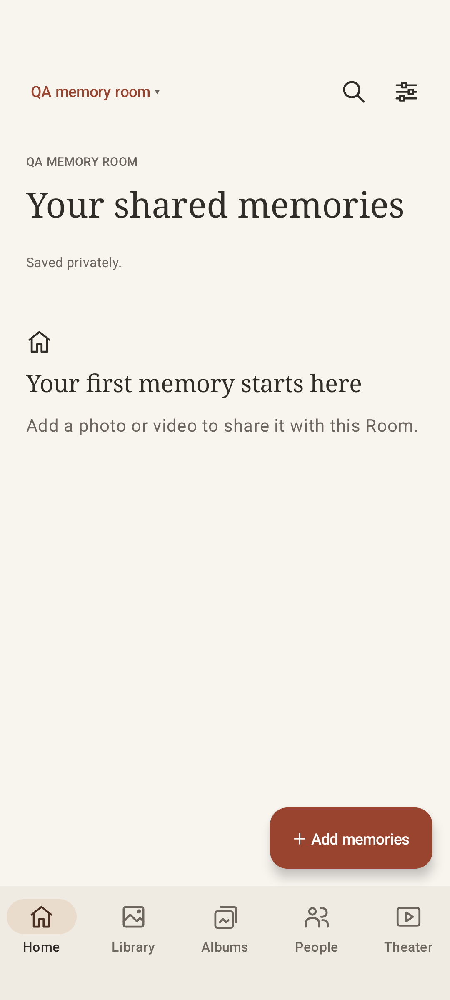
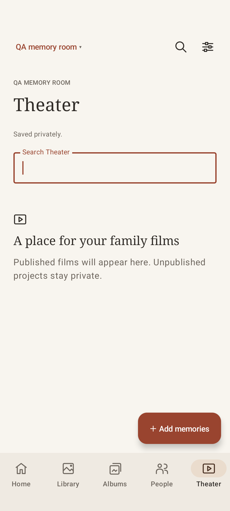

# Native interface review

Captured from the passing fresh-onboarding UI test on the Family Room QA iOS 27 iPhone 17 Pro simulator. The returning-member test also passes. A later run reached all navigation assertions but timed out during screenshot capture; the archived captures below are from the earlier passing run. Functional tests now request screenshots only when FAMILY_ROOM_CAPTURE_UI=1. An intermediate functional rerun failed after the desktop launcher killed the simulator app by executable name. After restricting restart to the exact macOS bundle path, the latest functional-only rerun passed with zero failures. These captures show an empty real catalog, without fabricated family content.

The test verifies explicit new-Room setup, returning to Home without reopening setup, normal settings controls, all five navigation destinations, Theater creation controls, and no unsolicited full-library Photos permission prompt. Photo observation now starts only for an enabled, authorized automatic-upload source. Prominent actions use white text on the brown accent, and phone titles and Theater actions fit their available space.

Populated libraries, iPad layout, dark mode, scalable text, keyboard navigation and screen-reader behavior still need rendered review. This is development evidence, not complete accessibility or cross-platform certification.

## Android

API 35 arm64 Pixel 7 emulator, real Keystore/JNI catalog and a Room created through native controls. NavigationTest verifies onboarding, five browsing destinations, separate settings, search/clear and activity restoration. Captures show an empty test Room. Rendered review found overlapping grid-item children; full-width sections now use explicit vertical layout. The coherent outline icons and warm navigation colors are original utility assets.

## macOS

The native window was inspected through computer-use controls after rebuilding. Creating a local validation Room opened setup; relaunch returned to Home without forcing setup. Home and its primary action were reviewed while the window was inactive. The primary-action style now keeps its foreground and background together. All five sections, Library empty-state copy and an empty private Film studio were manually opened. Separate toolbar identities retain the correct settings label after navigation. Further populated, large-text, dark-mode and keyboard/screen-reader checks remain open.

The current macOS Debug app uses an isolated persistent development library without Keychain access. A real validation Room survived rebuild/relaunch, and a synthetic ochre/blue PNG was imported through the native file picker. A private one-clip draft autosaved and reopened after rebuilding. Undo, Redo and Save draft are visible in the workspace heading; the docked timeline and bounded, rounded preview were inspected in a populated draft. Selecting the clip caused the Computer Use service to terminate with an Array.remove assertion; the app remained running and idle, with no Keychain wait in its process sample. This limits selected-inspector and rendered-preview UI certification. Actual split render correctness is separately covered by native movie tests. No test film was published to another person.
